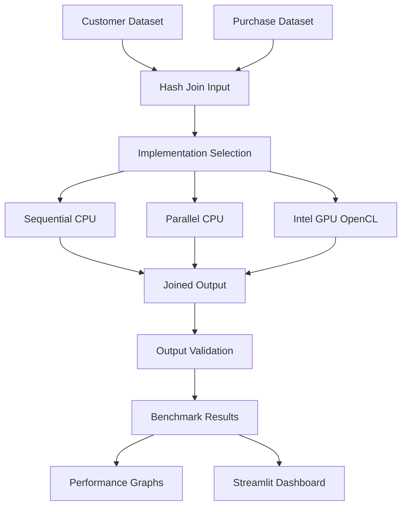
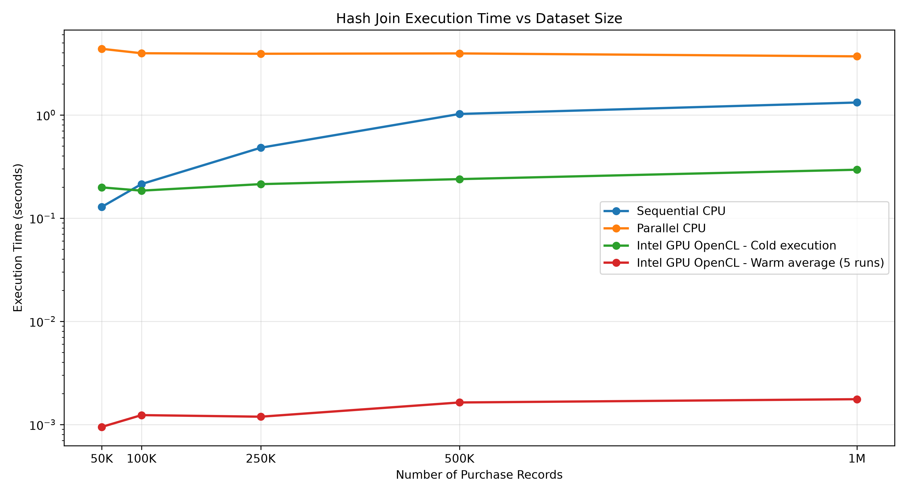
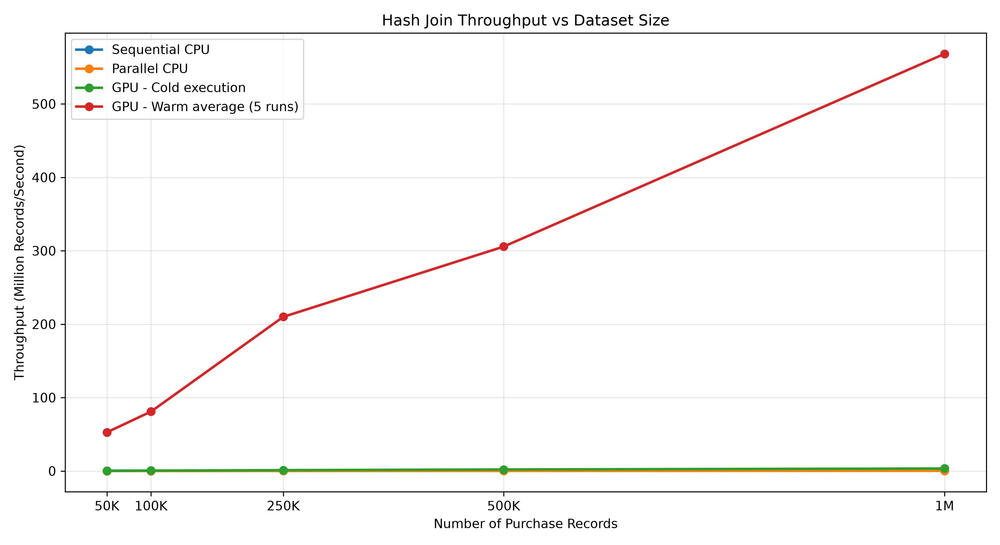
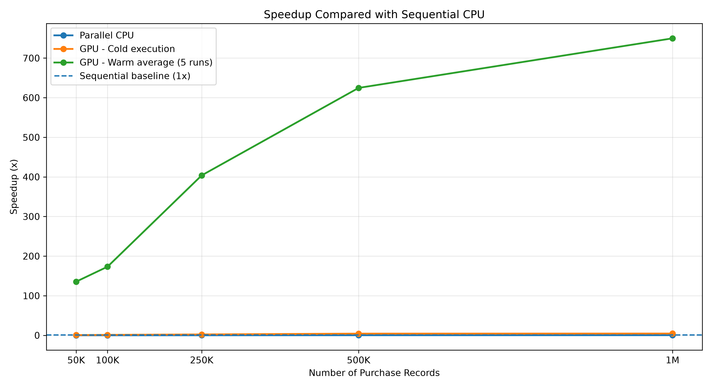

# ⚡ Parallel Hash Join: CPU vs GPU Performance Analysis

A performance benchmarking project comparing **Sequential CPU**, **Parallel CPU**, and **Intel GPU (OpenCL)** implementations of a hash join operation across multiple dataset sizes.

The project evaluates execution time, throughput, scalability, and speedup using Python, Pandas, multiprocessing, and OpenCL. It also includes a Streamlit dashboard for interactive performance analysis.

## 🚀 Project Overview

A hash join is an efficient database operation used to combine two tables based on a common key.

This project joins:

- **Customers:** Contains customer IDs and customer names.
- **Purchases:** Contains purchase IDs, customer IDs, and purchase amounts.

The implementations build a hash table using customer IDs and probe it with purchase records to produce the joined result.

The project compares three approaches:

1. **Sequential CPU:** Performs hash table construction and probing sequentially.
2. **Parallel CPU:** Uses Python multiprocessing to distribute purchase records across multiple worker processes.
3. **GPU OpenCL:** Uses Intel integrated GPU compute kernels to perform hash table construction and probing in parallel.

The implementations are tested using datasets containing 50,000, 100,000, 250,000, 500,000, and 1,000,000 purchase records.

## 🎯 Objectives

- Implement hash join using sequential CPU processing.
- Implement parallel hash join using multiprocessing.
- Accelerate hash join operations using Intel GPU and OpenCL.
- Compare execution time and throughput across implementations.
- Evaluate performance as dataset size increases.
- Validate that all implementations produce identical results.
- Visualize benchmark results through a Streamlit dashboard.

## 🏗️ System Architecture



### Implementation Architecture

**1. Sequential CPU**

- Loads customer and purchase datasets using Pandas.
- Constructs a Python dictionary using customer IDs as keys.
- Iterates through purchase records and looks up corresponding customer names.
- Produces the final joined dataset.

**2. Parallel CPU**

- Uses `ProcessPoolExecutor` to distribute purchase records across multiple processes.
- Constructs the customer lookup dictionary.
- Initializes worker processes with the lookup dictionary.
- Processes separate purchase chunks using Pandas mapping operations.
- Combines the processed chunks into the final result.

**3. Intel GPU OpenCL**

- Uses PyOpenCL to access the Intel integrated GPU.
- Creates an OpenCL context and command queue.
- Compiles GPU kernels for hash table construction and probing.
- Allocates and reuses GPU buffers.
- Executes the hash table build and probe operations on the GPU.
- Transfers the matched customer IDs back to the CPU.
- Constructs the final joined DataFrame using Pandas.

The GPU implementation uses a direct-address lookup table. This is suitable for the project's dense, positive customer IDs in the range 1–10,000. It is not a general-purpose collision-resolving hash table.

## 🧠 Algorithms and Technologies

| Component             | Algorithm / Technology                    |
| --------------------- | ----------------------------------------- |
| Hash Join             | Hash-based join                           |
| Sequential Processing | Python dictionary lookup                  |
| Parallel Processing   | Process-based parallelism                 |
| CPU Data Processing   | Pandas                                    |
| GPU Programming       | OpenCL                                    |
| GPU Hash Table        | Direct-address lookup                     |
| GPU Execution         | Parallel build and probe kernels          |
| Benchmarking          | Execution time and throughput measurement |
| Visualization         | Matplotlib                                |
| Dashboard             | Streamlit                                 |
| Data Generation       | NumPy                                     |

## 💻 Hardware Specifications

| Component          | Specification             |
| ------------------ | ------------------------- |
| Processor          | Intel Core Ultra 5 125U   |
| CPU Cores          | 12                        |
| Logical Processors | 14                        |
| GPU                | Intel Integrated Graphics |
| GPU Compute Units  | 64                        |
| GPU Driver         | 32.0.101.6790             |
| OpenCL Platform    | Intel OpenCL Graphics     |
| OpenCL Version     | 3.0                       |
| GPU Runtime        | Intel OpenCL 3.0 NEO      |

## 🛠️ Software Requirements

- Python
- Pandas
- NumPy
- PyOpenCL
- Matplotlib
- Streamlit
- psutil

## 📁 Project Structure

```text
Parallel-Hash-Join/
│
├── data/
│   ├── customers.csv
│   ├── purchases.csv
│   └── benchmarks/
│       ├── 50000/
│       ├── 100000/
│       ├── 250000/
│       ├── 500000/
│       └── 1000000/
│
├── src/
│   ├── generate_data.py
│   ├── generate_benchmark_data.py
│   ├── sequential_join.py
│   ├── parallel_join.py
│   ├── gpu_join.py
│   ├── benchmark.py
│   ├── scalability_benchmark.py
│   └── visualize_results.py
│
├── dashboard/
│   └── app.py
│
├── results/
│   ├── benchmark_results.csv
│   ├── scalability_results.csv
│   ├── scalability/
│   └── graphs/
│       ├── execution_time_comparison.png
│       ├── throughput_comparison.png
│       └── speedup_comparison.png
│
├── README.md
└── requirements.txt
```

## 📊 Dataset Details

The benchmark uses a fixed customer dataset and purchase datasets of increasing sizes.

| Dataset   | Customer Records | Purchase Records |
| --------- | ---------------: | ---------------: |
| Dataset 1 |           10,000 |           50,000 |
| Dataset 2 |           10,000 |          100,000 |
| Dataset 3 |           10,000 |          250,000 |
| Dataset 4 |           10,000 |          500,000 |
| Dataset 5 |           10,000 |        1,000,000 |

Dataset generation uses NumPy with a fixed random seed to maintain reproducibility.

All generated purchase customer IDs correspond to existing customer records, allowing the implementations to be compared using matching output records.

## 📈 Benchmark Results

The following measurements were obtained on the hardware listed above.

### Execution Time Comparison

| Purchase Records | Sequential CPU | Parallel CPU |   GPU Cold |   GPU Warm |
| ---------------: | -------------: | -----------: | ---------: | ---------: |
|              50K |     0.128493 s |   4.371666 s | 0.198501 s | 0.000948 s |
|             100K |     0.213884 s |   3.961555 s | 0.184680 s | 0.001234 s |
|             250K |     0.481042 s |   3.915458 s | 0.213542 s | 0.001191 s |
|             500K |     1.022072 s |   3.945637 s | 0.238863 s | 0.001636 s |
|               1M |     1.319747 s |   3.695251 s | 0.294593 s | 0.001760 s |

### Throughput Comparison

Throughput represents the number of purchase records processed per second.

| Dataset | Sequential CPU | Parallel CPU |     GPU Cold |       GPU Warm |
| ------: | -------------: | -----------: | -----------: | -------------: |
|     50K |     389,126.56 |    11,437.29 |   251,887.90 |  52,731,491.12 |
|    100K |     467,542.72 |    25,242.61 |   541,477.15 |  81,013,641.65 |
|    250K |     519,705.46 |    63,849.49 | 1,170,729.88 | 209,981,690.14 |
|    500K |     489,202.18 |   126,722.25 | 2,093,250.11 | 305,668,313.38 |
|      1M |     757,720.99 |   270,617.59 | 3,394,513.79 | 568,194,731.12 |

### Speedup Compared with Sequential CPU

| Dataset | Parallel CPU | GPU Cold | GPU Warm |
| ------: | -----------: | -------: | -------: |
|     50K |        0.03x |    0.65x |  135.54x |
|    100K |        0.05x |    1.16x |  173.33x |
|    250K |        0.12x |    2.25x |  403.90x |
|    500K |        0.26x |    4.28x |  624.74x |
|      1M |        0.36x |    4.48x |  749.86x |

**Important benchmarking distinction:**

- **GPU Cold:** Includes GPU initialization and first execution overhead.
- **GPU Warm:** Measures repeated executions while reusing the initialized OpenCL context, compiled kernels, and allocated buffers.

The GPU warm results are therefore not directly equivalent to cold-start, end-to-end application execution time. Both measurements are reported to make this distinction clear.

## 📉 Performance Graphs

### Execution Time Comparison



### Throughput Comparison



### Speedup Comparison



## 🔍 Performance Analysis

The benchmark results reveal several important observations:

**1. Sequential CPU Performance**

The sequential implementation provides a relatively consistent baseline. Its performance scales with the number of purchase records.

**2. Parallel CPU Performance**

The multiprocessing implementation is slower than the sequential implementation for all tested dataset sizes.

This is primarily due to process startup, data serialization, inter-process communication, and Pandas processing overhead. Parallelism does not automatically guarantee better performance when coordination costs exceed the benefits.

**3. GPU Performance**

The GPU cold execution includes initialization overhead. As dataset size increases, GPU cold execution becomes more competitive and reaches a 4.48x speedup at one million purchase records.

GPU warm execution demonstrates substantially higher throughput because it reuses previously initialized GPU resources.

At one million records, the measured warm execution speedup is 749.86x compared with the sequential baseline.

## ✅ Output Validation

Correctness is essential when comparing different implementations.

The project validates the generated output of the parallel CPU and GPU implementations against the sequential CPU output.

Validation checks include:

- Matching record counts.
- Sorting results by purchase ID.
- Comparing output DataFrames.
- Checking exact values while allowing compatible data types.

All five dataset sizes passed the output validation checks.

| Dataset | Sequential vs Parallel | Sequential vs GPU |
| ------: | ---------------------- | ----------------- |
|     50K | PASSED                 | PASSED            |
|    100K | PASSED                 | PASSED            |
|    250K | PASSED                 | PASSED            |
|    500K | PASSED                 | PASSED            |
|      1M | PASSED                 | PASSED            |

## 📊 Streamlit Dashboard

The project includes an interactive dashboard for analyzing benchmark results.

Dashboard features:

- Dataset-size selection.
- Implementation validation status.
- Key performance metrics.
- Benchmark results table.
- Execution time comparison.
- Throughput comparison.
- Speedup comparison.
- Exported performance graphs.
- CSV download of benchmark results.

### Run the Dashboard

```bash
streamlit run dashboard/app.py
```

Open the local URL displayed in your terminal, usually:

```text
http://localhost:8501
```

## ⚙️ Installation and Execution

### 1. Clone the Repository

```bash
git clone https://github.com/chaitu4206/Parallel-Hash-Join.git
cd Parallel-Hash-Join
```

### 2. Create a Virtual Environment

```bash
python -m venv venv
```

Activate it on Windows PowerShell:

```powershell
.\venv\Scripts\Activate.ps1
```

### 3. Install Dependencies

```bash
pip install numpy pandas matplotlib streamlit psutil pyopencl
```

An Intel OpenCL-compatible GPU driver and runtime are required for GPU execution.

### 4. Generate Benchmark Datasets

```bash
python src/generate_benchmark_data.py
```

### 5. Run Individual Implementations

Sequential CPU:

```bash
python src/sequential_join.py
```

Parallel CPU:

```bash
python src/parallel_join.py
```

GPU OpenCL:

```bash
python src/gpu_join.py
```

### 6. Execute the Complete Scalability Benchmark

```bash
python src/scalability_benchmark.py
```

### 7. Generate Performance Graphs

```bash
python src/visualize_results.py
```

### 8. Launch the Dashboard

```bash
streamlit run dashboard/app.py
```

## ⚠️ Limitations

- GPU acceleration currently relies on Intel OpenCL compatibility.
- The direct-address hash table assumes dense, positive customer IDs within the supported range.
- Multiprocessing overhead reduces performance for the tested workloads.
- GPU warm measurements reuse initialized resources and should be distinguished from cold-start measurements.
- The reported results are from the current benchmark runs; repeated independent trials and statistical summaries would improve measurement confidence.
- GPU result construction and DataFrame operations still involve CPU-side processing.

## 🔮 Future Enhancements

- Optimize multiprocessing through improved data partitioning and reduced serialization.
- Implement a general-purpose collision-resolving GPU hash table.
- Benchmark on additional GPU architectures.
- Add repeated trials, averages, standard deviations, and confidence intervals.
- Explore larger datasets and different join-key distributions.
- Investigate end-to-end GPU processing to reduce CPU-GPU data transfer.
- Extend the dashboard with hardware utilization and memory analysis.

## 🏁 Conclusion

This project demonstrates three different approaches to implementing hash joins using CPU and GPU computing.

The results highlight the importance of considering initialization overhead, data transfer, process coordination, and workload characteristics when evaluating parallel computing performance.

The Intel OpenCL GPU implementation achieved a measured warm speedup of **749.86x** over the sequential baseline for one million purchase records. Its cold-start speedup was **4.48x** for the same dataset.

The multiprocessing implementation was slower for the tested workloads, demonstrating that parallel processing overhead can outweigh the benefits of distributing work.

Overall, the project provides a practical comparison of sequential processing, CPU multiprocessing, and GPU acceleration.

---

**Technologies:** Python · Pandas · NumPy · Multiprocessing · PyOpenCL · Intel OpenCL · Matplotlib · Streamlit

**Project:** Parallel Hash Join Performance Analysis
